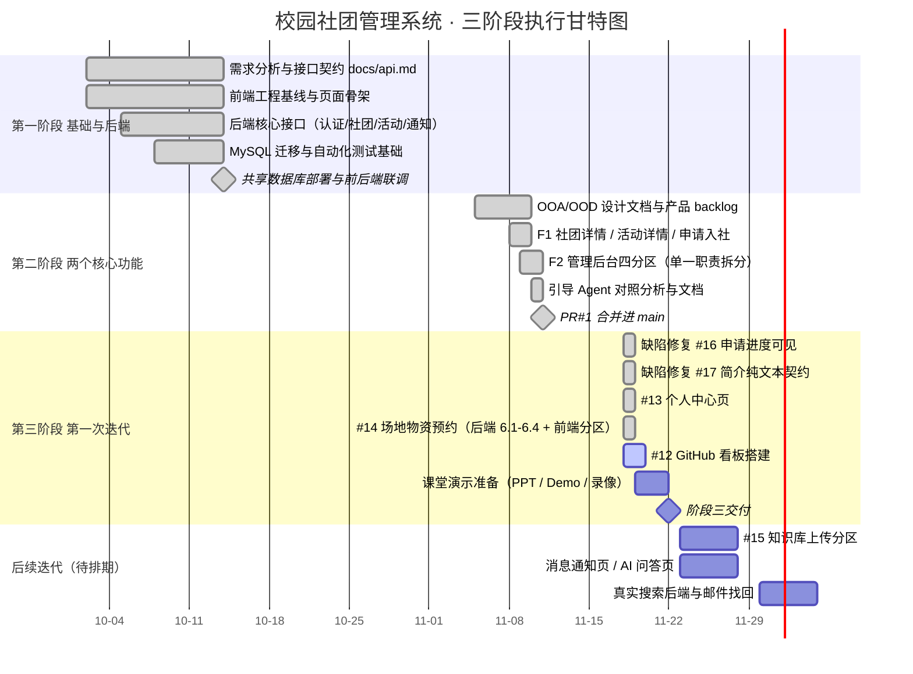

# 项目执行甘特图（三阶段）

> 更新：2026-11-18｜数据来源：`git log` 实际提交日期 + `docs/backlog.md` 状态
> 已完成段（`done`）按真实提交日期绘制；未标注 `done` 的段落为**建议排期**，需按课程实际截止日期校正。
> 渲染方式：GitHub / VS Code 直接预览 Mermaid 代码块。

## 与甘特图配套的进度口径

| 阶段 | 时间 | 交付物 | 状态 |
| ---- | ---- | ------ | ---- |
| 第一阶段 | 10-02 ~ 10-14 | 接口契约、后端 37 接口、MySQL 迁移与测试、共享开发库、前端工程基线 | 已完成 |
| 第二阶段 | 11-05 ~ 11-11 | OOA/OOD 设计文档、backlog、F1 + F2 两个核心功能前端、Agent 对照分析 | 已完成（PR#1） |
| 第三阶段 | 11-18 ~ | 第一次迭代：#13 个人中心、#14 场地物资预约、#16/#17 缺陷修复、#12 看板 | 进行中 |
| 后续迭代 | 待定 | #15 知识库、通知页、AI 问答、真实搜索、邮件找回 | 未开始 |

## 核心功能完成度（用于课堂「至少 60%」口径）

- **F1 查阅社团信息（个人）**：社团广场 → 社团详情（含公告/近期活动）→ 申请入社 → 活动报名 → 个人中心查看申请与报名结果，链路闭合。**≈100%**
- **F2 管理社团（社团管理者）**：社团资料编辑、活动管理（新建/发布/下架/删除）、招新审核（通过/拒绝 + 招新帖）、成员权限管理、场地物资预约五个分区已实现；知识库上传分区仍为占位。**≈85%（5/6 分区）**
- **系统管理员**：登录与全局审批接口（预约审批 6.4）可用，但**没有独立管理后台界面**，本阶段按组内决定收窄为「仅社长管理本社团」。**≈30%，属已知缺口**
