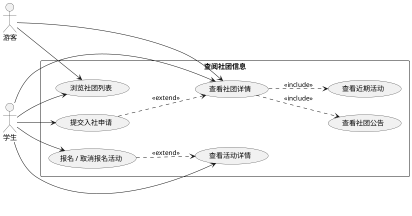
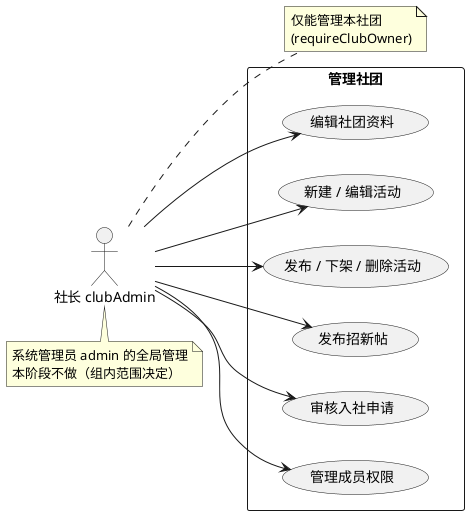
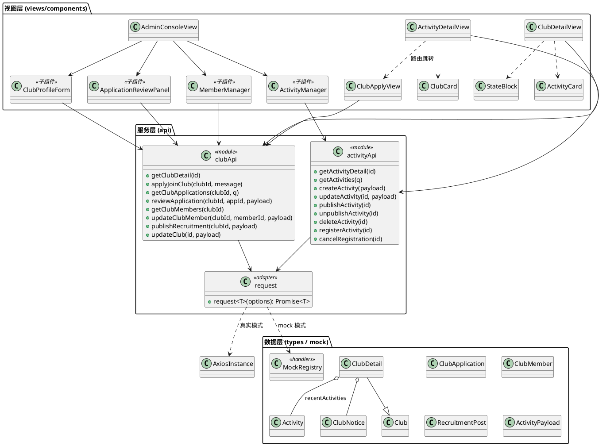
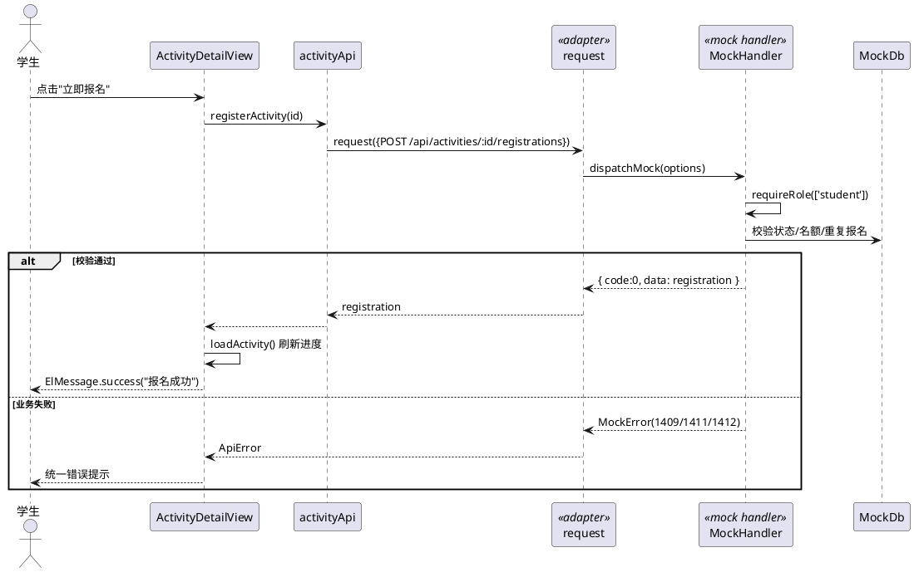
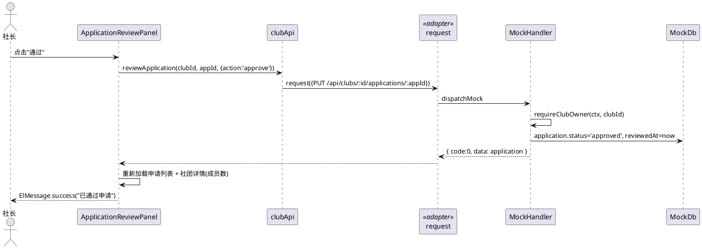
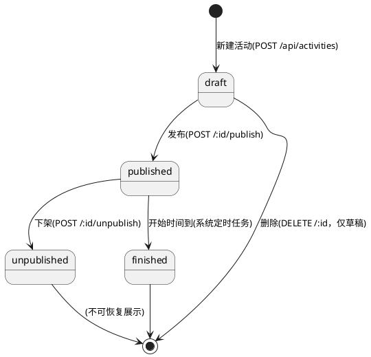

# 第二阶段设计文档：社团信息查阅 与 社团管理（前端部分）

> 作者：前端组（2 人）｜日期：2026-11-10｜分支：`feature/phase2-core-frontend`
>
> 本文档是第二阶段"先分析设计、再用设计引导 Agent 实现"流程的产物。
> §1–§4 为面向对象分析（OOA），§5 为面向对象设计（OOD），§6 为设计模式应用，
> §7 为"设计引导 Agent"的约束清单，§8 为与"无设计直出"版本的对照分析。

---

## 1. 需求概述（需求变更分析）

第二阶段在阶段一（框架 + 首页/广场/登录 + 连通性页面）基础上，新增两个核心功能：

| 编号 | 核心功能 | 使用者 | 范围 |
| ---- | -------- | ------ | ---- |
| F1 | 查阅社团信息 | 学生（个人） | 社团详情、活动详情、活动报名、入社申请 |
| F2 | 管理社团 | 社长（clubAdmin） | 社团资料编辑、活动管理、招新帖与入社申请审核、成员权限管理 |

明确**不做**的（避免范围蔓延，写进 backlog 的 Notes）：场地物资预约、知识库上传、AI 问答、消息通知页——属其他阶段或其他组接口，本阶段保留占位。

## 2. 用况图（Use Case）

### 2.1 F1 查阅社团信息

说明：游客可浏览；报名与入社申请必须登录（学生角色），未登录时系统引导跳转登录页（`publicOnly` 守卫之外的 `requiresAuth` 守卫）。

### 2.2 F2 管理社团

## 3. 类图（前端静态结构）

设计要点：**单一职责**——`AdminConsoleView` 只做"标签容器 + 数据分发"，四个业务分区拆为四个子组件，各自只依赖自己用到的 api 方法。这是与"无设计直出"版本最大的结构差异（见 §8）。

## 4. 顺序图（关键流程）

### 4.1 学生报名活动

### 4.2 社长审核入社申请

## 5. 状态图（活动生命周期）

报名状态：`registered → cancelled`（活动开始前可取消），与活动状态联动校验（未发布不可报名、名额满不可报名）。

包图：视图层 `src/views` / 组件层 `src/components` / 服务层 `src/api` / 数据层 `src/types` + `src/mock`，依赖方向只允许自上而下（视图→服务→数据），禁止反向依赖（与 CLAUDE.md 一致）。

## 6. 设计模式应用（OOD）

| 模式 | 应用位置 | 解决的问题 |
| ---- | -------- | ---------- |
| **适配器模式 (Adapter)** | `src/api/request.ts` | 把 mock 数据源与 axios 真实请求统一为同一个 `request<T>()` 接口，`VITE_USE_MOCK` 是唯一开关，页面代码零改动 |
| **状态管理（统一三态）** | `src/components/StateBlock.vue` | loading / error / empty 三态统一渲染，数据页只关心数据加载函数 |
| **观察者模式** | `src/stores/user.ts` + 路由守卫 + 401 拦截 | 登录态变化自动驱动路由跳转与请求头注入 |
| **单一职责（组件拆分）** | `AdminConsoleView` → 4 个子组件 | 每个子组件只负责一个业务分区，独立加载、独立依赖 api 方法 |
| **策略模式（隐含）** | 活动状态决定操作按钮策略 | draft→[发布,删除]，published→[下架]，finished→[只读] |

## 7. 用设计引导 Agent：约束清单

以下条目来自上面的类图与顺序图，作为给 Agent 的实现约束（也是"设计引导 Agent"的核心证据，见 `docs/agent-guidance-log.md`）：

1. 页面只能调用 `src/api/*` 导出的方法，禁止直接 axios / fetch / mock。
2. 所有请求走 `request<T>()`；mock 与真实返回信封 `{code,message,data}` 必须一致。
3. `AdminConsoleView` 不得把四个分区的逻辑写在一个文件里；必须拆出 `ClubProfileForm`、`ActivityManager`、`ApplicationReviewPanel`、`MemberManager` 四个子组件（放 `src/views/admin/components/`）。
4. 每个数据页必须有 loading / error / empty 三态，用 `StateBlock`。
5. 活动操作按钮按状态图渲染（draft/published/finished 策略不同）。
6. 样式只用 `variables.css` 变量；组件 `<style scoped>`。
7. 提交前 `npm run lint`、`npm run type-check` 零报错。

## 8. 对照分析：设计引导 Agent vs 无设计直出

> 背景：阶段二开始前，我们曾让 Agent 在无设计文档的情况下直接生成全部页面（版本 A，已删除）。
> 版本 B 为本分支按本文档约束生成的实现。差异记录如下：

| 维度 | 无设计直出（版本 A） | 设计引导（版本 B） |
| ---- | -------------------- | ------------------ |
| AdminConsoleView 结构 | 单文件约 890 行，4 个业务分区混杂，重复的状态/加载逻辑散落各处 | 容器 + 4 个单一职责子组件，每个子组件独立加载与刷新 |
| 可测试性 | 难以单测，需整页挂载 | 子组件可独立评审/测试 |
| 可讲解性 | 讲不清"为什么这样组织" | 类图即代码结构，可对照讲解 |
| 与契约一致性 | 凭 Agent 记忆对齐 api.md，存在字段使用随意 | 类型定义先行（types/），视图严格按类型取字段 |
| 设计模式体现 | 无意识地使用了 request 适配器 | 显式命名并在文档中说明模式意图 |
| 返工成本 | 需求变动需在大文件中定位多处 | 修改集中在单一子组件 |

结论：即便是"让 Agent 写代码"，**先有设计再约束 Agent**，产出在结构清晰度、可维护性、可讲解性上显著优于直出；同时设计文档成为课堂展示"人工评审过程"的直接证据。
